# PHÂN TÍCH WEBSITE MẪU

Cập nhật: 2026-10-15. Xem trên máy tính, khung 1024×768.
Cách xem: cuộn từng đoạn và chụp khung hình, rê chuột, bấm thử, đọc code chuyển động của trang.
Chưa xem bản điện thoại.

---

## 1. neutomni.com

**Tóm tắt:** studio làm web. Nền trắng, chữ đỏ một màu. Chữ đậm thường xen chữ nghiêng có chân để nhấn. Mỗi phần một kiểu bố cục và một kiểu chuyển động riêng, nhưng vẫn chung một hệ màu và chữ.
**Công cụ:** GSAP (ScrollTrigger, SplitText, MorphSVG), Lenis để cuộn mượt. Trang chỉ có một trang, không chuyển trang.

### Từng phần, theo thứ tự cuộn

**1. Mở đầu.** Logo NEUTOMNI chữ rất lớn chạy hết chiều ngang. Câu "We build websites for people" xếp dọc, mỗi dòng một chữ. Góc dưới có giờ địa phương chạy theo giây và nút "Open for work".

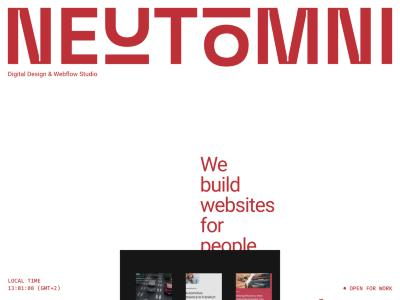

**2. Lưới tác phẩm thu phóng.** Cuộn xuống thì một khung tối nở ra kín màn hình. Bên trong là lưới 6 ô ảnh dự án. Cuộn tiếp thì các ô thu nhỏ dần thành chấm, rồi lộ ra một mockup website.

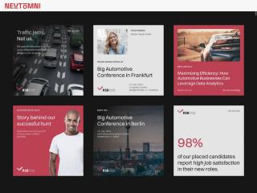 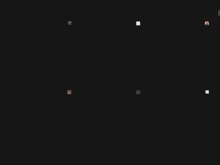

**3. Câu giới thiệu.** Chữ lớn, nửa đứng nửa nghiêng. Từng dòng hiện dần khi cuộn tới (chữ được tách dòng rồi trượt lên). Có ảnh nhỏ của 2 người sáng lập.

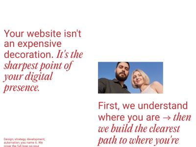

**4. Quy trình 4 bước.** Đây là phần đáng học nhất.
- 4 cột đỏ, lúc đầu cao thấp lệch nhau như bậc thang.
- Một đường gợn sóng chạy ngang, câu bên trên: "Đường có thể gập ghềnh, chúng tôi giữ cho bạn đi tiếp."
- Cuộn tới thì các cột lên cùng độ cao, đường gợn sóng thẳng lại.
- Rê chuột ngang, một hình vẽ nét đi theo chuột trên đường kẻ đứt. Qua mỗi cột, hình biến dạng và xoay (lục giác → tròn…), để lại vệt mờ dần. Điện thoại thì kéo bằng tay.
- Ý nghĩa: biến hỗn loạn thành ngăn nắp.

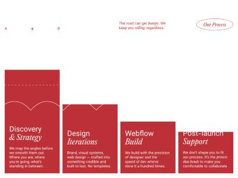 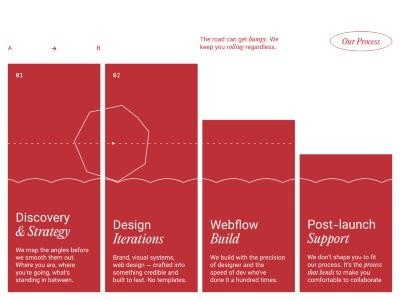 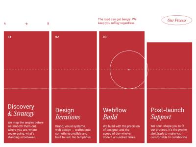

**5. Selected Work.** Tiêu đề chữ lớn bên trái. Danh sách dự án đánh số 01, 02, 03 kèm nhãn nhỏ. Phần này được ghim lại khi cuộn. Bên phải, ảnh dự án lớn trượt thay nhau theo từng dòng.

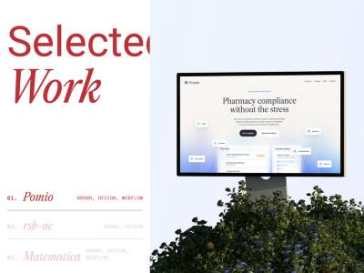

**6. Chuyển cảnh chữ mờ.** Nền gradient mờ. Câu "We keep our focus on important things" hiện từ mờ sang rõ.

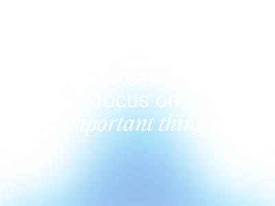

**7. Bảng giá kiểu vé.** 3 thẻ giá trông như vé có mã vạch và đường xé. Thẻ thứ ba nghiêng 3D.

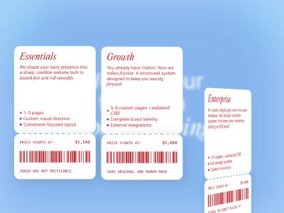

**8. Màn hình desktop.** Cuộn tiếp thì bảng giá thu nhỏ thành một cửa sổ "Pricing.html" trên màn hình desktop kiểu Windows XP. Bên phải có icon ảnh từng thành viên, thư mục Testimonials, file FAQ.md. Bấm icon thì mở cửa sổ. Cửa sổ kéo thả được, bấm vào thì nổi lên trên.

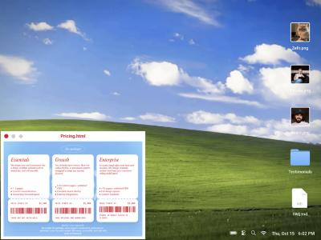

**9. Kết.** Cả desktop thu nhỏ vào một màn hình máy tính cũ. Bên dưới là nút "Contact" và câu kêu gọi.

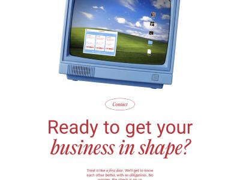

---

## 2. toyfight.co/work

**Tóm tắt:** studio thiết kế. Nền kem, chữ đen. Chữ mono nhỏ, nhãn dạng viên thuốc. Thông tin ít chữ, xếp theo lưới đều. Khó lạc.
**Công cụ:** Next.js. Chuyển động tự viết.

### Từng bước

**1. Màn chờ.** Nền đen, 3 viên "LOADING · PLS · WAIT". Từng viên sáng dần theo tiến độ tải. Trang tải khá lâu.

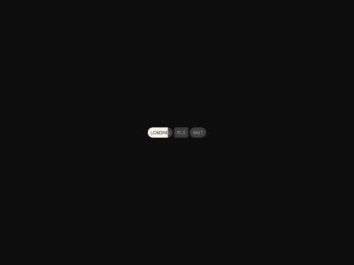

**2. Vào trang.** Một khối đen trượt khỏi màn hình theo hình bậc thang. Các thẻ dự án hiện lần lượt từ trái qua phải.

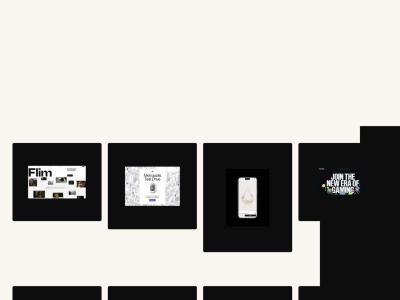

**3. Lưới dự án.** 4 cột. Mỗi thẻ là khung đen bo góc, video hoặc ảnh chạy bên trong, tên dự án là nhãn nhỏ dưới góc. Khung cao thấp theo tỉ lệ ảnh (ảnh điện thoại thì khung cao hơn). Bên trái là bộ lọc: Featured (8), All, Website, Marketing, eCommerce, Branding, Content.

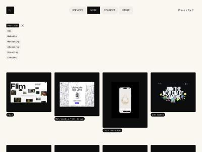 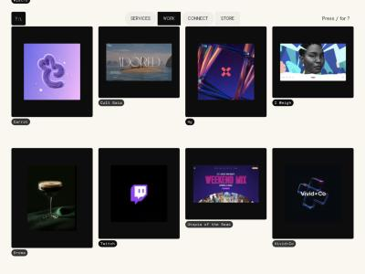

**4. Lọc.** Bấm một mục thì số lượng nhảy sang mục đó, ví dụ "Marketing (10)". Thẻ cũ rút đi, thẻ mới trượt vào chỗ trống. Nhãn tên hiện sau cùng.

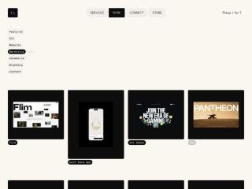

**5. Chuyển trang.** Bấm một dự án thì các khối đen phủ màn hình theo hình bậc thang chéo. Hiện màn chờ ngắn rồi mở trang dự án.

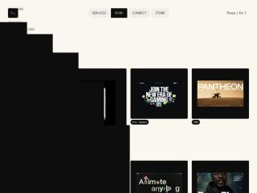

**6. Trang dự án.** Tên và câu giới thiệu nằm trong nhãn. Nền giấy kẻ ô. Có vài con trỏ chuột giả mang tên người (Alex, Susie, Noah) như đang cùng làm việc, và vài vật thể trang trí 3D. Bên dưới là 5 nhãn dịch vụ, 2 đoạn mô tả ngắn, nút xem trang thật. Sau đó là các khung đen lớn chứa video màn hình, xếp nối nhau.

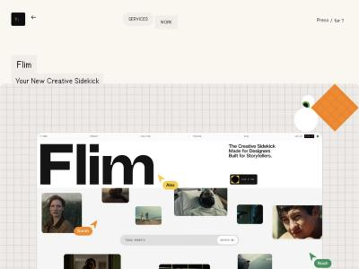 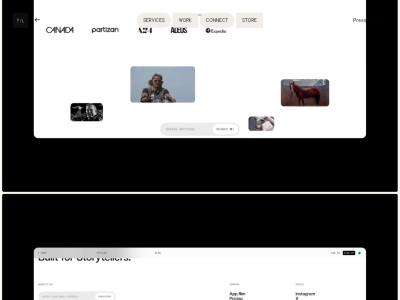

**7. Footer.** Câu "The Unmistakably Original® Design Studio". Mỗi chữ là một ô, tự đổi chữ liên tục như máy quay số.

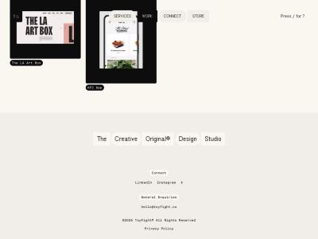

**Khác:** menu dạng viên thuốc ở giữa, trang đang xem tô đen. Góc phải có gợi ý phím tắt "Press / for ?".

---

## 3. Nên học gì cho XINH.OS

Chỉ học cách trình bày và chuyển động. Nội dung vẫn theo file bàn giao.

| Thấy ở mẫu | Dùng cho phần nào của Xinh |
|---|---|
| Desktop kiểu OS, cửa sổ kéo thả, icon mở cửa sổ (neutomni) | Đúng tinh thần XINH.OS. Dùng cho Hồ sơ, Liên hệ, Cách hợp tác: mỗi thứ là một "file" hay "cửa sổ". |
| Quy trình: cột lệch thành đều, đường gợn sóng thành thẳng (neutomni) | Cách làm 4 bước của Xinh (Làm rõ → Cấu trúc → Quản lý triển khai → Theo đến kết quả). Ý "gỡ rối" hiện ra ngay khi cuộn, không cần bấm. |
| Danh sách dự án đánh số, ghim lại, ảnh trượt bên cạnh (neutomni) | Dự án chọn lọc, 5 case. Tên khách hàng là chữ lớn. |
| Lưới thẻ + bộ lọc có số đếm (toyfight) | Trang Dự án. Lọc theo tính chất hoặc theo khách hàng. Bấm vào là đọc được ngay. |
| Trang dự án: nhãn ngắn, ít chữ, media lớn (toyfight) | Trang chi tiết case: Bối cảnh / Vai trò / Đóng góp / Phần của team / Kết quả. |
| Câu chữ nửa đứng nửa nghiêng, hiện dần từng dòng (neutomni) | Headline "Xinh thích làm chủ." và các câu chính. |
| Chữ đổi liên tục kiểu quay số (toyfight) | Có thể dùng ở footer, ví dụ đổi lần lượt các vai trò mục tiêu. Chỉ dùng chữ đã duyệt. |
| Chuyển trang bằng khối phủ bậc thang (toyfight) | Chuyển giữa trang chính, trang Dự án và trang case. |

**Không nên lấy:**
- Màn chờ lâu của toyfight. Portfolio cần mở nhanh.
- Màu xanh của neutomni (nền trời, gradient xanh). Xinh không dùng xanh cho UI. Nếu cần nền trời thì chỉ làm không khí.
- Khung đen lớn của toyfight. Xinh không thích đen trắng nặng.
- Chuyển động phải bấm hay rê chuột mới thấy nội dung. Chuyển động chỉ làm đẹp, nội dung phải đọc được ngay.
